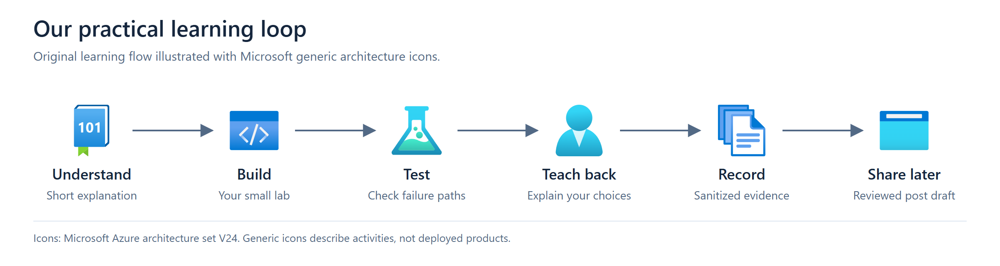
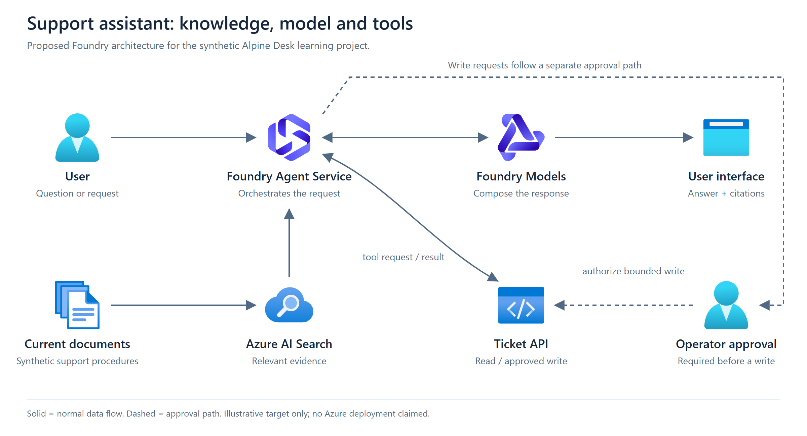
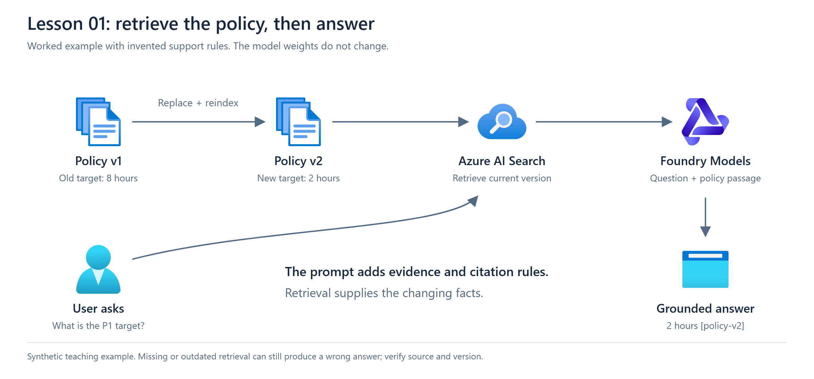

# AI-103 Practical Labs

Learning AI engineering through a small support assistant: explain, build, test, teach back.

**Author:** Rahul Chamoli / Kaizen-Ryu. **Teacher:** Codex in the learning session.

This is an independent study repository, not an official Microsoft course. The first lesson is ready; no Azure application has been deployed and no lab has been completed by the learner yet.

## How we learn



Each lesson has a scenario, acceptance criteria, a short practical task and a teach-back question. A teacher demonstration is recorded separately from work the learner completes.

## One project, several lessons

We will build a support assistant using invented product documents. It should cite its sources, say when evidence is missing, and obtain permission before changing a ticket.



This is the target architecture, not a claim of running integration.

| Lesson | Practical outcome | Initial status |
| --- | --- | --- |
| 01 Design choices | Explain model, retrieval, tools, identity and budget decisions | Ready to start |
| 02 First Foundry call | Make and inspect a Python model request | Planned |
| 03 Grounded answers | Retrieve synthetic notes, cite evidence and handle missing answers | Planned |
| 04 Tools and agent behavior | Inspect tool calls and test a rejected write request | Planned |
| 05 Multimodal workflows | Exercise image, text, speech and document scenarios | Planned |
| 06 Evaluation and revision | Measure failures, review service choices and repeat weak topics | Planned |

The lessons map to the [current AI-103 study guide](https://learn.microsoft.com/en-us/credentials/certifications/resources/study-guides/ai-103). They do not replace full syllabus coverage or the official practice assessment.

## This week's focus

| Day | Proposed study focus |
| --- | --- |
| Tuesday 13 October | Diagnostic, design decisions and Foundry setup |
| Wednesday 14 October | Python, retrieval and agents |
| Thursday 15 October | Failure cases, security and multimodal tasks |
| Friday 16 October | Practice, wrong-answer review and rest; exam at 21:45 IST |

## Start here: lesson 01

You are designing an assistant for an invented product, Alpine Desk. Its support procedures change weekly, its ticket status changes throughout the day, and ticket closure needs operator approval.

Answer these three questions in your own words:

1. For changing procedures, would you choose retrieval, a prompt or fine-tuning? Give a reason and a limitation.
2. For the live status of ticket ALP-104, which component supplies the answer? What happens if it times out?
3. Before closing that ticket, what identity, authorization, confirmation and duplicate-request checks should the application perform?

Acceptance: distinguish model behavior, current knowledge and external actions; justify the design; explain a failure path. A generated tool request is not permission to act. These are original teaching questions, not recalled exam questions.

### Worked example: a changing support policy



Alpine Desk's invented P1 response target changes from **8 hours** in policy v1 to **2 hours** in policy v2. A user asks, "What is our P1 response target?"

The application retrieves the current policy passage and includes it with the question and instructions to cite its source. The illustrated answer is **"2 hours [policy-v2]"**. This is a worked teaching example, not output from a deployed model.

- **Prompt:** instructions such as "use supplied evidence and cite it." A tiny document can also be included directly if context fits.
- **Retrieval:** finds the relevant current passage. For frequently changing documents, RAG is a practical first choice; refresh the index when sources change.
- **Fine-tuning:** changes learned behavior or style. It is not the first choice for keeping weekly policy facts current.
- **Tool:** fetches a ticket's live status or performs an authorized operation. Documents are not a substitute for the live ticket API.

If retrieval misses policy v2, the answer can still be stale. If no reliable evidence exists, report uncertainty. If the ticket API times out, do not invent a current status. Validate identity and authorization before a ticket write, request operator approval, and prevent duplicate actions.

Try it manually: give a model your question alone, then supply only policy v2 as evidence with a citation instruction. Compare answers and record whether the citation supports the claim. Do not mark this lab completed until you have run and explained the comparison yourself.

The learner log remains local. See [icon sources and editable diagrams](assets/README.md).

## Repository layout

```text
docs/
  intent.md          scope and learning boundaries
  status.md          current evidence and next action
  progress.md        learner-completed work and open gaps
  lessons/           scenarios and acceptance criteria
  diagrams/          reviewed architecture diagrams
src/                 Python application modules, added with the labs
tests/               meaningful checks, added with implementation
infra/               bounded Azure definitions, added after setup approval
content/             LinkedIn drafts based on verified work
```

Only existing maintained files are committed; the tree also shows planned code directories. Credentials, raw screenshots, private exam records and deployment state stay out of Git.

## Turning learning into content

One completed lab can produce a short post: problem, illustrated flow, observed result, limitation and repository link. Do not claim production use, a certification pass, client results or learner completion without evidence. Posts require Rahul's review and a separate publish instruction.

## Sources

Checked 13 October 2026:

- [AI-103 blueprint](https://learn.microsoft.com/en-us/credentials/certifications/resources/study-guides/ai-103)
- [Credential and official practice assessment](https://learn.microsoft.com/en-us/credentials/certifications/azure-ai-apps-and-agents-developer-associate/)
- [Foundry retrieval grounding](https://learn.microsoft.com/en-us/azure/foundry/concepts/retrieval-augmented-generation)
- [Foundry agents overview](https://learn.microsoft.com/en-us/azure/foundry/agents/overview)
- [Official Microsoft Azure architecture icons](https://learn.microsoft.com/en-us/azure/architecture/icons/)

Use original scenarios and public synthetic data. No exam dumps or copied assessment questions.
